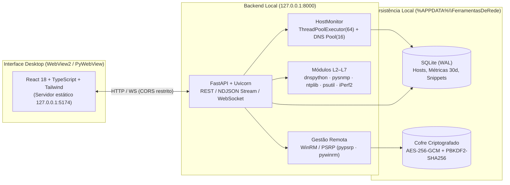

<div align="center">


# Ferramentas de Rede

**Suíte desktop portátil para engenharia de redes, observabilidade multi-VLAN, diagnóstico L2–L7, auditoria de segurança e gestão remota Windows.**

[](https://github.com/raphaelredes/ferramentasderede/releases/latest)
[](https://github.com/raphaelredes/ferramentasderede/actions/workflows/ci.yml)
[](https://github.com/raphaelredes/ferramentasderede/releases/latest)
[](#arquitetura)
[-0ea5e9?style=flat-square)](#instala%C3%A7%C3%A3o-e-execu%C3%A7%C3%A3o)

[Download (Release)](https://github.com/raphaelredes/ferramentasderede/releases/latest) · [Website Oficial](https://www.ferramentasderede.com.br/) · [Reportar Bug](https://github.com/raphaelredes/ferramentasderede/issues/new?template=bug_report.md) · [Solicitar Recurso](https://github.com/raphaelredes/ferramentasderede/issues/new?template=feature_request.md) · [Segurança](SECURITY.md)

</div>

---

## Visão Geral

**Ferramentas de Rede** é uma estação de trabalho portátil voltada a analistas de redes, equipes de NOC e administradores de sistemas que operam em **ambientes corporativos multi-VLAN e multi-domínio Active Directory**.

Em vez de depender de uma colcha de retalhos de binários avulsos ou de empacotar um navegador Chromium inteiro (~400 MB), o projeto entrega um **executável único portátil (~44 MB)** que combina um backend assíncrono em **Python/FastAPI** com uma interface **React/TypeScript** renderizada nativamente pelo **Microsoft Edge WebView2** — sem necessidade de instalador nem privilégios administrativos para abrir (`uac_admin=False`).

### Diferenciais de Engenharia

- **Multi-NIC / Multi-VLAN de primeira classe**: seleção explícita de IP de origem (`source_ip`) e servidor DNS por rede gerenciada em Ping, MTR, TCP Ping, Scanner de Rede, PTR Sweep, DNS e iPerf2.
- **Multi-Domínio Active Directory**: resolução DNS determinística por segmento, fallback automático de formatos de credencial WinRM (`DOMINIO\usuario` / `usuario@dominio`) e classificação estruturada de erros (`AUTH_FAILED`, `CROSS_DOMAIN_AUTH`, `WINRM_DISABLED`, `TRUSTED_HOSTS_REQUIRED`).
- **Conformidade de Licenciamento**: 100% das dependências empacotadas utilizam licenças permissivas (MIT, BSD, ISC, Apache-2.0, PSF) ou MPL-2.0 sem modificação — sem componentes GPL/LGPL (o teste de banda usa `iperf2.exe` nativo sob NCSA/BSD, sem `cygwin1.dll`, e rotinas ICMP usam utilitários nativos do SO). Veja [THIRD-PARTY-LICENSES.txt](THIRD-PARTY-LICENSES.txt).

---

## Arquitetura



| Camada | Tecnologias | Papel Técnico |
| :--- | :--- | :--- |
| **Container Desktop** | `pywebview` + Microsoft Edge WebView2 | Renderização nativa sem embutir Chromium; pré-checagem do runtime com bootstrapper oficial embarcado |
| **Frontend** | React 18, TypeScript, Vite, Tailwind CSS, Recharts, `@dnd-kit` | Dashboard reativo, gráficos de latência/sparklines, persistência de estado e autocomplete global de hosts |
| **Backend & API** | Python 3, FastAPI, Uvicorn, Pydantic v2, WebSockets | Execução concorrente de diagnósticos, streaming NDJSON em tempo real e broadcast de eventos |
| **Persistência** | SQLite (WAL + `RLock` + retry exponencial) | Inventário de hosts, séries temporais (30 dias), snippets e backup automático diário |
| **Segurança** | `cryptography` (AES-256-GCM, PBKDF2-HMAC-SHA256) | Cofre de credenciais local protegido por senha mestra e validação rígida de entradas |
| **Empacotamento** | PyInstaller (`python/build_webview.spec`) | Binário único portátil Windows x64 (`~44 MB`) sem processos de console visíveis (`CREATE_NO_WINDOW`) |

---

## Funcionalidades

### 1. Monitoramento & Painel Principal (Dashboard)

- **Monitoramento contínuo em escala**: agendador baseado em `ThreadPoolExecutor(64)` com resolução paralela de DNS/MAC (`ThreadPoolExecutor(16)`) e atualização em tempo real via WebSocket com backoff exponencial.
- **Detecção Smart Offline**: evita falsos positivos em oscilações isoladas de ICMP e dispara notificações nativas do Windows + toasts em transições reais de disponibilidade.
- **Observabilidade histórica**: gravação periódica em SQLite (retenção automática de 30 dias) com cálculo de uptime (24h / 7d), latência, perda de pacotes, **Jitter (RFC 1889)** e pontuação **MOS (VoIP)**.
- **Organização Multi-VLAN**: classificação automática de hosts por CIDR cadastrado (badges e filtros por rede), grupos customizados, ordenação Drag & Drop persistente, monitoramento de portas TCP por host e **autocomplete global** de hosts do painel em todas as ferramentas.

### 2. Suíte de Diagnóstico & Rede (22 Ferramentas em 6 Categorias)

| Categoria | Ferramenta | Capacidades Técnicas |
| :--- | :--- | :--- |
| **Diagnóstico** | **Ping** | ICMP nativo com seleção de `source_ip` (multi-NIC), streaming ao vivo e estatísticas |
| | **Traceroute** | Rastreamento estruturado (NDJSON) com mapeamento **BGP ASN** por salto via Team Cymru DNS (RFC 1035), grafo topológico e console bruto |
| | **MTR (Path Monitor)** | Monitoramento contínuo salto a salto com perda%, min/méd/máx, **Jitter (RFC 1889 / RFC 3550)** e sparklines SVG |
| | **TCP Ping** | Teste de alcançabilidade e RTT via handshake TCP (ideal quando ICMP é bloqueado por firewall) com suporte a `source_ip` |
| | **Path MTU** | Descoberta binária do maior MTU sem fragmentação (diagnóstico de MTU black hole em VPN/VLAN) |
| | **Interfaces Ativas** | Auditoria remota via WinRM de enlaces Wi-Fi/LAN (SSID, BSSID, sinal), perfis **802.1X/EAP**, políticas RSOP e inspetor de certificados digitais |
| **Active Directory** | **Diagnóstico AD** | Matriz das 9 portas essenciais de DC (`53, 88, 135, 389, 445, 464, 636, 3268, 3269`), validação DNS SRV (`_ldap`, `_kerberos`, `_kpasswd`, `_gc`), **Kerberos Time Skew**, descoberta das **5 FSMO Roles** e status de replicação (`repadmin`) |
| **Descoberta & L2** | **Scanner de Rede** | Varredura paralela de sub-redes CIDR, resolução OUI/IEEE local atualizável sob demanda, inferência de tipo de ativo, listagem de IPs livres, abas fixáveis e exportação CSV (RFC 4180) |
| | **Switch / L2 (LLDP)** | Captura passiva de quadros **LLDP (IEEE 802.1AB)** e **CDP** para identificação de switch, porta física e VLAN sem credenciais |
| | **Pastas SMB** | Enumeração de compartilhamentos SMB/CIFS públicos e administrativos (`C$`, `ADMIN$`) com auditoria de acesso |
| | **Conflitos ARP** | Inspeção da tabela ARP para detecção de múltiplos MACs respondendo pelo mesmo IP (conflito estático / ARP spoofing) |
| | **Scanner de Portas** | Varredura TCP streaming por lista, faixa ou portas comuns com cancelamento imediato |
| | **PTR Sweep** | Resolução DNS reversa em massa de toda uma faixa CIDR respeitando o servidor DNS da VLAN |
| **DNS & Nomes** | **Consulta DNS** | Diagnóstico RFC 1035/7766/8499 (`A, AAAA, CNAME, MX, TXT, NS, SOA, PTR, SRV, CAA`), fallback UDP→TCP, validação SPF/FCrDNS, benchmark multi-provedor (`8.8.8.8`, `1.1.1.1`, `9.9.9.9`, `208.67.222.222` + DNS internos) e visualização estilo ISC BIND `dig` |
| | **Certificado TLS** | Extração completa da **Chain of Trust** (folha/intermediária/raiz), matriz de protocolos **PCI-DSS** (TLS 1.0–1.3), avaliação de cifras (**PFS + AEAD**), negociação **ALPN** e suporte a CAs internas/auto-assinadas |
| **Banda & Web** | **Banda (iPerf2)** | Binário `iperf2.exe` nativo embarcado operando em modo **Servidor** ou **Cliente** (TCP/UDP, modo reverso e bind de interface `-B`) |
| | **Tráfego** | Taxa instantânea de RX/TX (bps–Gbps) por adaptador de rede em tempo real via deltas de contadores `psutil` |
| | **HTTP Web Health** | **Waterfall de 5 fases** (DNS, TCP, TLS, TTFB, Download), rastreamento de redirects e auditoria de cabeçalhos de segurança **OWASP** (HSTS, CSP, X-Frame-Options, X-Content-Type-Options, Referrer-Policy, Permissions-Policy) |
| **Infra & Cálculo** | **SNMP (v1/v2c/v3)** | Suporte nativo a **SNMPv3 USM (`authPriv` HMAC-SHA-256/SHA-1/MD5 + AES-256/AES-128/DES)**, tabela de interfaces (`ifTable` RFC 1213/2863), MIB Walk, sonda RFC 3414 EngineID, **Auditoria de Postura (NIST SP 800-123 / CISA TA17-156A)**, teste não-destrutivo de escrita e templates de hardening |
| | **NTP** | Consulta de offset, delay, stratum e referência com alerta crítico para risco de falha **Kerberos** (> 5 min) |
| | **Sub-rede** | Calculadora CIDR completa (rede, broadcast, faixa útil, máscara, wildcard) com subdivisão em sub-redes |
| | **Conexões** | Inspeção de sockets TCP/UDP locais correlacionados com PID e nome do processo (`netstat` filtrado) |

### 3. Gestão Remota, Automação & Relatórios

- **Terminal Remoto WinRM / PSRP**: sessão interativa PowerShell/CMD com seletor de hosts, preenchimento automático de domínio e opção de terminal externo sem exposição de credenciais no histórico.
- **Multi-Host Action Runner**: execução paralela de comandos/scripts em lote com console segmentado por host e **Biblioteca de Snippets** persistida em SQLite.
- **Acesso Remoto & Energia**: integração nativa com **RDP**, **MSRA**, **TeamViewer** (descoberta de ID no registro) e **HopToDesk** (detecção e implantação automatizada via SMB/WinRM); **Wake-on-LAN**, envio de mensagens (`msg.exe`), reinicialização/desligamento via WinRM com modal de pré-checagem (uptime, sessões ativas e reboot pendente).
- **Relatórios Técnicos**: geração de inventário de rede e auditoria de SLA/latência em HTML responsivo pronto para impressão/PDF via endpoint local.

---

## Modelo de Segurança

- **Superfície de ataque restrita a loopback**: a API FastAPI faz bind estrito em `127.0.0.1:8000` (nunca exposta à LAN por padrão) com CORS restrito às origens locais (`5173`/`5174`).
- **Cofre de credenciais local**: encriptação autenticada **AES-256-GCM** com chave derivada via **PBKDF2-HMAC-SHA256 (600.000 iterações)** e salt criptográfico aleatório de 32 bytes; escrita atômica com `RLock` e limpeza de chave em memória ao bloquear.
- **Higiene de credenciais em subprocessos**: senhas nunca são interpoladas em linhas de comando ou gravadas em logs; sessões externas recebem credenciais via variáveis de ambiente efêmeras removidas imediatamente na inicialização do script.
- **Classificação pré-voo de protocolos inseguros**: operações com credenciais em texto claro (ex.: SNMPv1/v2c) classificam o destino (RFC 1918 / RFC 4193 vs. WAN pública) e exigem confirmação explícita antes do envio em redes externas.
- **Princípio do menor privilégio**: o executável roda sem elevação (`uac_admin=False`), solicitando UAC pontualmente apenas quando o operador modifica `TrustedHosts` no Registro do Windows.

Detalhes adicionais sobre divulgação de vulnerabilidades estão em [SECURITY.md](SECURITY.md).

---

## Instalação e Execução

### Opção 1: Executável Portátil (Recomendado)

1. Baixe o binário mais recente em [**GitHub Releases**](https://github.com/raphaelredes/ferramentasderede/releases/latest) (`Ferramentas.de.Rede.v<versão>.exe`).
2. Execute diretamente — não requer instalação nem privilégios de administrador.

**Requisitos de ambiente:**
- **Windows 10 ou Windows 11 (64-bit)**.
- **Microsoft Edge WebView2 Runtime** (pré-instalado no Windows 11; em máquinas Windows 10 limpas, o próprio aplicativo detecta a ausência e oferece instalação assistida usando o bootstrapper oficial da Microsoft embarcado no executável).

> **Nota sobre o Windows SmartScreen:** por ser um binário portátil sem certificado de assinatura de código (EV/OV), o SmartScreen pode exibir um aviso na primeira execução. Verifique o hash SHA-256 publicado na página da release antes de prosseguir em *Mais informações → Executar mesmo assim*.

---

## Desenvolvimento & Build Portátil

### Pré-requisitos

- **Python 3.12+** (recomendado 3.13 para build Windows)
- **Node.js 20+** e `npm`
- **PyInstaller** (`pip install pyinstaller`) para gerar o executável portátil

### Executando em Modo Desenvolvimento

```powershell
# 1. Instalar dependências do backend
cd python
pip install -r requirements.txt

# 2. Instalar dependências da interface
cd ..\electron
npm install

# 3. Iniciar backend + interface de desenvolvimento (a partir da raiz)
cd ..
python python\main.py
```

Para executar apenas o backend FastAPI isoladamente:

```powershell
cd python
python -m api.server
# Smoke test:
curl http://127.0.0.1:8000/
```

### Compilando o Executável Portátil (~44 MB)

> **Importante:** o pipeline oficial de empacotamento é exclusivamente **Python + PyInstaller + WebView2** (`python/build_webview.spec`). O comando `npm run build` em `electron/` é bloqueado propositalmente para evitar a geração de pacotes Chromium/Electron (~400 MB).

Na raiz do repositório:

```powershell
cmd /c build_system.bat
```

O script executa `npm install` → `npx vite build` → `pyinstaller build_webview.spec --clean --noconfirm`, gerando o artefato final em:

```text
python\dist\Ferramentas.de.Rede.v<versão>.exe
```

Para instruções detalhadas e solução de problemas de empacotamento, consulte [python/BUILD_README.md](python/BUILD_README.md).

### Variáveis de Ambiente

| Variável | Padrão | Descrição |
| :--- | :--- | :--- |
| `NT_API_HOST` | `127.0.0.1` | Endereço de bind do servidor Uvicorn |
| `NT_API_PORT` | `8000` | Porta TCP da API FastAPI |
| `NT_WEBVIEW_PORT` | `5174` | Porta do servidor HTTP estático local do WebView2 |
| `NT_CORS_ORIGINS` | `localhost/127.0.0.1` (`5173`, `5174`) | Lista CSV de origens CORS permitidas |
| `NT_APP_VERSION` | `electron/package.json` | Sobrescrita opcional de versão em tempo de execução |
| `NT_WEBVIEW_DEBUG` | `0` | Define `1` para habilitar DevTools no modo portátil |

### Persistência Local

Todos os dados do operador são gravados no perfil do usuário (nunca no diretório do executável):

| Caminho | Conteúdo |
| :--- | :--- |
| `%APPDATA%\FerramentasDeRede\` | Banco SQLite (hosts, métricas, snippets), configurações e cache OUI (`mac-vendors.txt`) |
| `%APPDATA%\FerramentasDeRede\credentials.enc` | Cofre criptografado (AES-256-GCM) |
| `%APPDATA%\FerramentasDeRede\errors.log` | Logs de erro do backend e sessões WinRM |

---

## Estrutura do Repositório

```text
ferramentasderede/
├── .github/
│   ├── ISSUE_TEMPLATE/         # Templates de reporte de bugs e sugestões
│   └── workflows/              # Pipeline CI (tsc, vite, py_compile, pytest, audit) e WinGet
├── electron/                   # Interface web React + TypeScript + Vite + Tailwind
│   ├── src/
│   │   ├── components/         # Painéis das 22 ferramentas, Dashboard, Terminal, Relatórios
│   │   ├── contexts/           # Estado global (Monitoring, Tools, Vault, Toast)
│   │   ├── data/changelog.ts   # Histórico versionado exibido na interface
│   │   └── pages/              # Telas principais da aplicação
│   └── package.json            # Fonte única de verdade da versão do aplicativo
├── python/                     # Backend FastAPI + Empacotamento portátil PyWebView
│   ├── api/                    # Entry point Uvicorn e routers REST/WebSocket
│   ├── src/
│   │   ├── config/             # Resolução de versão e APP_DATA_DIR
│   │   ├── core/               # SQLite (WAL), HostManager e persistência
│   │   ├── network/            # Motores L2–L7 (Ping, MTR, SNMP, DNS, TLS, AD, iPerf, LLDP...)
│   │   ├── security/           # Cofre criptografado AES-256-GCM
│   │   └── system/             # WinRM/PSRP, scripts PowerShell, Batch Runner e Backup
│   ├── bin/                    # iperf2.exe (NCSA/BSD) e WebView2 Evergreen Bootstrapper
│   ├── main_webview.py         # Entry point do executável portátil
│   └── build_webview.spec      # Especificação PyInstaller single-file
├── build_system.bat            # Pipeline automatizado de build portátil
├── TESTES.html                 # Roteiro técnico de validação manual offline
├── THIRD-PARTY-LICENSES.txt    # Avisos e licenças de componentes de terceiros
├── SECURITY.md                 # Política de segurança e divulgação responsável
└── CONTRIBUTING.md             # Diretrizes de contribuição e validação
```

---

## Validação e Testes

```powershell
# Frontend: checagem de tipos e build de produção
cd electron
npx tsc --noEmit
npx vite build

# Backend: compilação sintática e testes automatizados
cd ..\python
python -m compileall -q api src main_webview.py main.py
pytest -q tests/
```

Um roteiro estruturado de testes manuais (incluindo cenários multi-VLAN, segurança e Windows Sandbox) está disponível em [TESTES.html](TESTES.html).

---

## Documentação Adicional

- [Guia de Build Portátil](python/BUILD_README.md)
- [Política de Segurança](SECURITY.md)
- [Diretrizes de Contribuição](CONTRIBUTING.md)
- [Licenças de Terceiros](THIRD-PARTY-LICENSES.txt)
- [Histórico de Releases](https://github.com/raphaelredes/ferramentasderede/releases)

---

## Autor & Licenciamento

Desenvolvido por **Raphael Oliveira Rêgo** · [Website](https://www.ferramentasderede.com.br/) · [GitHub](https://github.com/raphaelredes)

O executável é distribuído gratuitamente (Freeware) com código-fonte público para auditoria e reconstrução. Os componentes de terceiros empacotados permanecem sob suas respectivas licenças permissivas conforme listado em [THIRD-PARTY-LICENSES.txt](THIRD-PARTY-LICENSES.txt).
